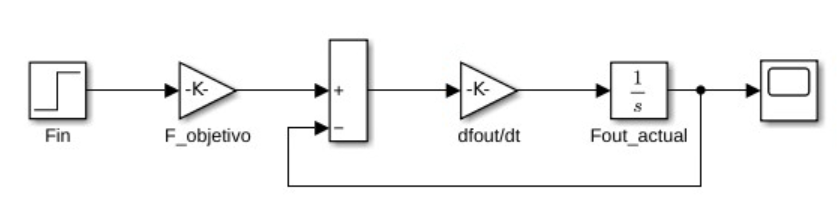
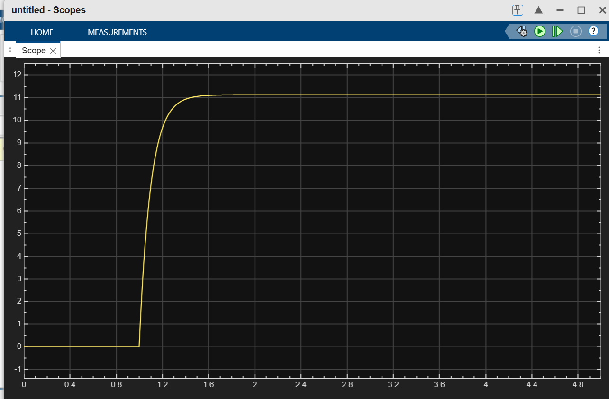

# Hydraulic Braking System: 1D Dynamics Simulation

## Overview
This repository contains a first-order dynamic simulation of a hydraulic braking system. The project demonstrates the translation of physical fluid dynamics (pressure build-up, dampening, and mechanical leverage) into both object-oriented C++ code and a 1D visual model using Simulink.

## Mathematical Model
Instead of a static calculation, this system models the hydraulic fluid resistance using a first-order ordinary differential equation (ODE). The numerical integration is performed using the **Euler Method**.

* **Target Force ($F_{target}$):** Calculated based on Pascal's principle and lever mechanical advantage (Area and Length ratios).
* **Time Constant ($\tau$):** Represents fluid dampening and friction delay.
* **Time Step ($dt$):** The simulation resolution (1 ms).

## C++ Architecture
The code is structured with strict Object-Oriented Programming (OOP) principles:
* **Encapsulation:** State variables are kept private and modified only through the integration method.
* **Const Correctness:** Physical parameters are declared as `const` variables inside the initializer list to prevent accidental state mutation.
* **Robustness:** Usage of `assert` to validate physical constraints (e.g., preventing division by zero).

## Simulink 1D Model
To validate the C++ algorithm, the mathematical logic was modeled in Simulink using a feedback loop structure. 

*(Here the Simulink layout computes the target gain, subtracts the current state, applies the dampening derivative, and integrates the signal over time).*



### System Step Response (Scope)
The scope output demonstrates the transient response of the system. The force does not spike instantly; instead, it ramps up and stabilizes asymptotically, physically representing the pressure build-up in the brake lines.



## How to Compile and Run
To run the C++ simulation via terminal:
```bash
g++ main.cpp SistemaFH.cpp -o hydraulic_brake.exe
./hydraulic_brake.exe